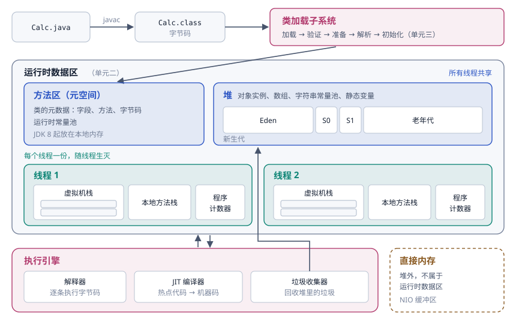

# 单元一 字节码与栈帧：一个方法是怎么跑起来的

本单元的核心：JVM 是一台“栈式机器”。每调用一个方法，就在线程的栈上压一个**栈帧**；字节码指令就在这个栈帧里，把数据在“局部变量表”和“操作数栈”之间搬来搬去、做计算。

**学完这个单元，你能：**

- 用 `javap` 读懂一段简单的字节码，说出每条指令让局部变量表和操作数栈发生了什么变化。
- 用栈帧解释 `i = i++` 为什么还是 0，以及 StackOverflowError 和哪些因素有关。
- 说出 JVM 由哪几部分组成，一个 `.java` 文件从编译到执行经过了哪些环节。

JVM 的知识点很多，但最好的起点是最小的那件事：一个方法到底是怎么执行的。顺序是：先看 JVM 的全貌（1.1），再用 `javap` 看一眼字节码（1.2），然后把字节码放进栈帧里一条条执行（1.3），接着看方法调用怎么让栈长高、长到多高会溢出（1.4），最后补上另外两块线程私有的区域（1.5）。

## 1.1 JVM 全景：从 .java 到运行

- **JDK、JRE、JVM**：JVM 负责运行字节码；JRE = JVM + 核心类库；JDK = JRE + 编译器（javac）和诊断工具（javap、jstat、jstack……）。我们平常装的就是 JDK，用的 JVM 是 OpenJDK 和 Oracle JDK 里的 **HotSpot**。
- **一次编写，到处运行**：javac 不直接生成机器码，而是生成**字节码**（`.class` 文件），它是 JVM 的“指令集”。每个平台各有一个 JVM 负责把字节码变成本地机器码去执行。Kotlin、Scala 也编译成字节码，所以同样能跑在 JVM 上。

一个 Java 程序跑起来，会依次经过 JVM 的三大部分：



从左往右读：类加载子系统把 `.class` 读进来，类的信息放进方法区（单元三）；运行时数据区里，堆和方法区所有线程共享，每个线程另有自己的虚拟机栈、本地方法栈和程序计数器（单元二）；执行引擎里，解释器逐条执行字节码，跑得多的“热点代码”交给 JIT 编译器编译成机器码（单元八），垃圾收集器负责回收堆里没用的对象（单元五到七）。

## 1.2 字节码：用 javap 看一眼

拿一个最简单的方法开刀（完整代码在 `examples/Calc.java`）：

```java
static int add(int a, int b) {
    int c = a + b;
    return c * 2;
}
```

编译后用 `javap -c Calc` 反汇编，JDK 17 输出：

```text
static int add(int, int);
  Code:
     0: iload_0
     1: iload_1
     2: iadd
     3: istore_2
     4: iload_2
     5: iconst_2
     6: imul
     7: ireturn
```

- 每行是一条指令，左边的数字是这条指令在方法字节码里的**偏移量**（第几个字节），1.5 节的程序计数器记的就是它。
- 指令名的第一个字母是数据类型：`i` 是 int，`l` 是 long，`f`、`d` 是浮点，`a` 是引用（reference）。
- `iload_0` 是“把第 0 个局部变量压到操作数栈顶”，`istore_2` 是“把栈顶弹出，存进第 2 个局部变量”，`iadd`、`imul` 从栈顶弹出两个数，算完再压回去。

再用 `javap -v Calc` 看完整信息，能看到几处关键内容（节选）：

```text
  minor version: 0
  major version: 61
Constant pool:
  #13 = Methodref          #14.#15        // Calc.add:(II)I
  ...
  static int add(int, int);
    Code:
      stack=2, locals=3, args_size=2
```

- **版本号 61** 对应 JDK 17。用十六进制看 `.class` 文件开头是 `cafe babe 0000 003d`：前 4 个字节是固定的“魔数”，后面 `0x3d` 就是 61。高版本 JDK 编译的类放到低版本 JVM 上跑，会报 `UnsupportedClassVersionError`。
- **常量池**存着类名、方法名、字段名、字符串字面量这些“符号”。`main` 里调用 `add` 的指令是 `invokestatic #13`，它只写了“去常量池 13 号找”，到运行时才把这个符号换成真正的方法地址（单元三的“解析”）。
- **`stack=2, locals=3`**：这个方法的操作数栈最深 2 层、局部变量表需要 3 个槽位（a、b、c）。这两个数在**编译时**就算好了，所以调用方法时 JVM 能直接分配一个大小正好的栈帧。

### 深入一层（可跳过）：Class 文件里还有什么

`.class` 文件是一串紧凑排列的字节，没有分隔符，按固定顺序存放：

| 顺序 | 内容 | 说明 |
| --- | --- | --- |
| 1 | 魔数 | `0xCAFEBABE`，表明这是一个 class 文件 |
| 2 | 版本号 | 次版本号 + 主版本号，JDK 8 是 52，JDK 17 是 61，JDK 21 是 65 |
| 3 | 常量池 | 字面量和符号引用，后面的各部分都通过编号引用它 |
| 4 | 访问标志 | public、final、abstract、是类还是接口 |
| 5 | 类、父类、接口索引 | 指向常量池里的类名 |
| 6 | 字段表 | 每个字段的名字、类型、修饰符 |
| 7 | 方法表 | 每个方法的名字、描述符、修饰符；字节码放在方法的 **Code 属性**里 |
| 8 | 属性表 | 源文件名、行号表、内部类等附加信息 |

方法的“描述符”是一种紧凑写法：`(II)I` 表示参数是两个 int、返回 int，`([Ljava/lang/String;)V` 表示参数是 String 数组、返回 void。

## 1.3 栈帧：局部变量表 + 操作数栈

每个线程都有一个**虚拟机栈**。线程每调用一个方法，就在栈顶压入一个**栈帧**；方法返回时，这个栈帧弹出。栈帧里有四样东西：

| 部分 | 存什么 | 大小什么时候定 |
| --- | --- | --- |
| 局部变量表 | 方法参数和局部变量，按槽位编号；实例方法的 0 号槽位是 `this`，long 和 double 各占两个槽位 | 编译时（`locals`） |
| 操作数栈 | 计算用的临时数据，指令从这里取数、往这里放结果 | 编译时（`stack`） |
| 动态链接 | 指向当前方法所属类的运行时常量池，用来把 `#13` 这样的符号引用换成真实地址 | — |
| 返回地址 | 方法返回后，调用方从哪条指令继续 | — |

学字节码只需要盯住前两样。把栈帧想成一个**工位**：

- **局部变量表**是工位上一排编了号的抽屉，每个变量占一个抽屉。
- **操作数栈**是工位中间的一个托盘，东西只能从最上面放、从最上面拿。
- 字节码就是操作说明：`iload_1` = 从 1 号抽屉拿出一个数放到托盘最上面；`iadd` = 从托盘上拿走最上面两个数，相加后把结果放回托盘；`istore_2` = 把托盘最上面的数收进 2 号抽屉。

按这个思路把 `add(3, 4)` 走一遍：参数 a=3、b=4 已经在 0 号和 1 号抽屉里；`iload_0`、`iload_1` 把 3 和 4 放上托盘；`iadd` 换成 7；`istore_2` 收进 2 号抽屉（c=7）；`iload_2`、`iconst_2` 放上 7 和 2；`imul` 换成 14；`ireturn` 把 14 交给调用方，栈帧弹出。

**先看一个反直觉的现象**：`examples/IPlusPlus.java`

```java
int i = 0;
i = i++;
System.out.println("i = i++ 之后，i = " + i);

int j = 0;
j = ++j;
System.out.println("j = ++j 之后，j = " + j);
```

JDK 17 实测输出：

```text
i = i++ 之后，i = 0
j = ++j 之后，j = 1
```

`i++` 明明加了 1，`i` 却还是 0。看字节码就清楚了（`javap -c IPlusPlus`，节选）：

```text
// i = i++              // j = ++j
0: iconst_0             19: iconst_0
1: istore_1             20: istore_2
2: iload_1              21: iinc   2, 1
3: iinc   1, 1          24: iload_2
6: istore_1             25: istore_2
```

关键在 `iinc`：它**直接改抽屉里的值**，不经过托盘。

- `i = i++`：先 `iload_1` 把 i 的旧值 0 放上托盘，再 `iinc` 把抽屉里的 i 改成 1，最后 `istore_1` 把托盘上的 0 收回 1 号抽屉，**覆盖**了刚加好的 1。
- `j = ++j`：先 `iinc` 把抽屉里的 j 改成 1，再 `iload_2` 把 1 放上托盘，`istore_2` 存回去的也是 1。

“后置 ++ 先取值再自增”，在字节码里就是“先 load 再 iinc”。

## 1.4 方法调用与 StackOverflowError

方法 A 调用方法 B，就在 A 的栈帧上面再压一个 B 的栈帧；B 返回，B 的栈帧弹出，回到 A 继续。递归就是同一个方法的栈帧一层层往上叠。每个栈帧有自己的一套抽屉，所以每一层递归的局部变量互不干扰。

线程的栈大小是固定的（`-Xss` 设置），栈帧叠到装不下，就抛 **StackOverflowError**。`examples/StackDepth.java` 用两个递归方法测能叠多少层：一个没有局部变量，一个有 8 个 long 局部变量。为了让结果稳定，加了 `-Xint`（只用解释器执行，单元八会讲为什么 JIT 会让层数每次不同）。JDK 17 实测：

| 栈大小 | 没有局部变量 | 8 个 long 局部变量 |
| --- | --- | --- |
| `-Xss256k` | 1479 层 | 634 层 |
| `-Xss1m` | 9671 层 | 4145 层 |
| 默认（这台机器是 2MB） | 20594 层 | 8826 层 |
| `-Xss4m` | 42439 层 | 18188 层 |

- **栈越大，能叠的层数越多**，大致成正比。256k 那一行偏少，是因为栈底有一段固定的保护区，栈越小它占的比例越大。
- **栈帧越大，层数越少**：8 个 long 占 16 个槽位，每层栈帧变大，同样的栈只能放下一半不到。
- 默认栈大小和平台有关：Linux x64 上是 1MB，这台 macOS（Apple 芯片）上是 2MB。用 `java -XX:+PrintFlagsFinal -version | grep ThreadStackSize` 可以查。
- 不加 `-Xint` 时，默认栈下“没有局部变量”的方法两次分别叠了 45860 层和 45964 层，比只用解释器时多一倍还多，而且每次都不一样。所以“递归多少层会溢出”没有固定答案。

栈也不是越大越好。每个线程都要占一份栈空间，`-Xss` 设得太大，能创建的线程就少了。线上遇到 StackOverflowError，先看异常栈里反复出现的那个方法，多半是递归没有正确的结束条件，而不是栈不够大。

## 1.5 程序计数器与本地方法栈

除了虚拟机栈，每个线程还有两块私有的小区域：

- **程序计数器**：记录当前线程执行到哪条字节码，存的就是 1.2 节那一列偏移量。CPU 会在多个线程之间来回切换，切回来时要知道从哪里接着跑，所以**每个线程一个，互不干扰**。执行 native 方法时它的值是空的（undefined）。它是唯一一块规范里不会发生 OutOfMemoryError 的区域。
- **本地方法栈**：给 native 方法（用 C/C++ 实现的方法）用的栈，比如 `Thread.sleep()`、`Object.hashCode()`。jstack 里看到的 `(Native Method)` 就是正在执行这类方法。HotSpot 把它和虚拟机栈合成了一个栈。

到这里，线程私有的三块区域都见过了：虚拟机栈、本地方法栈、程序计数器。它们随线程创建而创建、随线程结束而销毁，方法一返回栈帧就弹出，**不需要垃圾回收**。需要 GC 操心的是线程共享的那部分，下一单元开始讲。

## 面试这样说

**问：栈帧里有什么？`i = i++` 为什么还是原来的值？**

> 每次方法调用，JVM 在线程的虚拟机栈上压一个栈帧，里面有局部变量表、操作数栈、动态链接和返回地址；局部变量表和操作数栈的大小在编译时就确定了。字节码是基于栈的指令，load 把局部变量压到操作数栈，store 把栈顶弹回局部变量。`i = i++` 编译成 iload、iinc、istore 三条：iload 先把旧值压栈，iinc 直接在局部变量表里把 i 加一，最后 istore 又把栈上的旧值写回 i，加一的结果被覆盖了。

**问：什么情况下会 StackOverflowError？和什么有关？**

> 线程栈的大小是固定的，由 -Xss 设置。方法调用一层就压一个栈帧，递归太深、栈帧叠满了就抛 StackOverflowError。能叠多少层取决于栈大小和每个栈帧的大小，局部变量越多栈帧越大；JIT 编译前后栈帧大小也不同，所以层数不是固定值。排查时看异常栈里重复出现的方法，一般是递归缺少正确的结束条件，盲目调大 -Xss 还会减少能创建的线程数。

## 自测

- [ ] `javap -c` 里的 `iload_1`、`iadd`、`istore_2` 分别做了什么？
- [ ] `i = i++` 执行完 i 为什么还是 0？用局部变量表和操作数栈解释。
- [ ] 栈帧里有哪几部分？局部变量表和操作数栈的大小是什么时候确定的？
- [ ] 同样的 -Xss，为什么方法的局部变量越多，能递归的层数越少？
- [ ] 程序计数器为什么要线程私有？它会发生 OOM 吗？
- [ ] 一个 `.java` 文件从编译到执行，经过了 JVM 的哪几部分？
