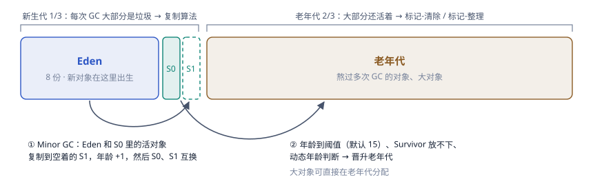

# 单元六 回收算法与分代：对象的一生

本单元的核心：三种基础回收算法各有短板：**标记-清除**留碎片，**复制**浪费空间，**标记-整理**要搬家。分代就是按对象的寿命把堆分开，让每一块用最合适的算法。

**学完这个单元，你能：**

- 说出三种回收算法的过程和优缺点。
- 讲清一个对象从 Eden 出生、在 Survivor 之间搬家、到晋升老年代的全过程，并在 GC 日志里认出这些变化。
- 分清 Young GC、Mixed GC、Full GC，说出 Full GC 的常见触发原因。

单元五回答了“谁是垃圾”，本单元回答“垃圾怎么清”。顺序是：先看三种基础算法（6.1），再看为什么要按寿命分代（6.2），然后跟着 GC 日志看一个对象的一生（6.3），接着解决分代带来的跨代引用问题（6.4），最后把各种 GC 的名字理清楚（6.5）。

## 6.1 三种基础算法

| 算法 | 做法 | 优点 | 缺点 |
| --- | --- | --- | --- |
| 标记-清除 | 标记出活对象，把其余的空间回收 | 简单，不移动对象 | 留下**内存碎片**，大对象可能找不到连续空间；分配要用空闲列表 |
| 复制 | 内存分成两半，只用一半；把活对象复制到另一半并紧凑排好，原来那一半整块清空 | 没有碎片；只处理活对象，活得少时极快 | **浪费一半空间**；活对象多时复制成本高 |
| 标记-整理 | 标记出活对象，把它们往一端挪，清掉边界以外的空间 | 没有碎片，也不浪费空间 | 要**移动对象**并更新所有引用，停顿更长 |

三种算法的取舍，归结起来就是一句话：活对象少，就用复制，搬几个活的走、整块清空最省事；活对象多，复制太贵，就用标记-清除或标记-整理。4.1 节说的“整理过的堆用指针碰撞，没整理的只能用空闲列表”，就是这里的结果。

## 6.2 分代：按寿命分区

大量统计表明两个规律：

- **绝大多数对象朝生夕灭**：方法里 new 的临时对象、一次请求里用的 DTO，用完就成了垃圾。
- **熬过越多次 GC 的对象，越难死**：缓存、连接池、Spring 的单例 Bean，会一直活到程序结束。

既然寿命差别这么大，就把堆分成两块，分别对待：

- **新生代**：存新对象，每次 GC 绝大部分都是垃圾、活下来的很少，正适合**复制算法**。
- **老年代**：存活得久的对象，每次 GC 大部分都还活着，复制不划算，用**标记-清除**或**标记-整理**。



新生代又分成一个 **Eden** 和两个 **Survivor**（S0、S1），默认比例 8:1:1（`-XX:SurvivorRatio=8`）。每次只用 Eden 和其中一个 Survivor，GC 时把活对象复制到另一个 Survivor。这样复制算法只“浪费”了 10% 的新生代，而不是一半。新生代和老年代的比例默认是 1:2（`-XX:NewRatio=2`），G1 会动态调整。

## 6.3 对象的一生

把规则串起来，一个对象从出生到“养老”是这样的：

1. **在 Eden 出生**：新对象在 Eden 分配（4.2 节的 TLAB 也在 Eden 里）。
2. **Eden 满了，触发 Minor GC**（只回收新生代的 GC，也叫 Young GC）：把 Eden 和正在用的那个 Survivor（叫 from）里的活对象，复制到空着的那个 Survivor（叫 to），年龄加 1；然后清空 Eden 和 from，from 和 to 互换角色。
3. **年龄到了阈值，晋升老年代**：默认 15（`-XX:MaxTenuringThreshold`），因为对象头里的年龄只有 4 位（4.3 节）。
4. **动态年龄判断**：如果 Survivor 里某个年龄及以下的对象加起来超过了 Survivor 的一半，那么大于等于这个年龄的对象直接晋升，不用等到 15。
5. **Survivor 放不下，提前晋升**：活对象太多，to 区装不下，放不下的直接进老年代。
6. **大对象直接进老年代**：很大的数组如果在 Survivor 之间来回复制，代价太高。Serial 等收集器可以用 `-XX:PretenureSizeThreshold` 设一个门槛；G1 有专门存放大对象的 Humongous 区（7.5 节）。

**跟着 GC 日志看一次 Minor GC**：`examples/MinorGC.java` 用 Serial 收集器和固定的小堆，让日志最容易读。新生代 10MB（Eden 8MB + 两个 Survivor 各 1MB），先分配三个 2MB 的数组 a1、a2、a3，再分配一个 4MB 的 a4。JDK 17 加 `-Xlog:gc,gc+heap=info` 实测（`DefNew` 是 Serial 的新生代，`Tenured` 是它的老年代）：

```text
---- 已分配 a1、a2、a3 共 6MB，接下来分配 4MB 的 a4
[0.020s][info][gc,heap] GC(0) DefNew: 7127K(9216K)->453K(9216K) Eden: 7127K(8192K)->0K(8192K) From: 0K(1024K)->453K(1024K)
[0.020s][info][gc,heap] GC(0) Tenured: 0K(14336K)->6144K(14336K)
[0.020s][info][gc     ] GC(0) Pause Young (Allocation Failure) 6M->6M(23M) 1.066ms
---- a4 分配完成
```

- Eden 里已有 7127K（a1 到 a3 共 6MB，加上 JVM 启动时自己创建的对象），放不下 4MB 的 a4，触发了一次 Young GC，原因是 `Allocation Failure`（分配失败）。
- a1 到 a3 都还被引用着，是活对象，但 Survivor 只有 1MB，装不下 6MB，于是**直接进了老年代**：`Tenured: 0K->6144K`，正好 6MB。JVM 自己那 453K 小对象进了 Survivor（From）。
- GC 后 Eden 清空，a4 顺利分配在 Eden。

**再看年龄是怎么涨的**：`examples/Tenuring.java` 让一个 128KB 的数组一直活着，同时不停地分配垃圾，触发多次 Minor GC。为了少等几轮，把晋升阈值设成 3，新生代 20MB（Survivor 各 2MB）。加 `-Xlog:gc+age=trace` 能看到 Survivor 里每个年龄有多少字节（JDK 17 实测，节选）：

```text
GC(0) - age   1:     593280 bytes,     593280 total
GC(0) Tenured: 0K(20480K)->0K(20480K)
GC(1) - age   2:     593152 bytes,     700288 total
GC(2) - age   3:     593152 bytes,     700208 total
GC(3) Tenured: 0K(20480K)->579K(20480K)
```

这批 579K 的对象（128KB 的数组加上 JVM 自己的对象）在前三次 GC 里年龄从 1 涨到 3，一直待在 Survivor；第四次 GC 时到了阈值，搬进老年代，`Tenured` 从 0K 变成 579K。

动态年龄判断也能在日志里看到。同一个程序，把新生代缩小到 10MB（`-Xmn10m`，Survivor 各 1MB），第一次 GC 后活下来的 593280 字节超过了 Survivor 的一半（524288 字节），JVM 当场把阈值从 3 降到了 1：

```text
GC(0) Desired survivor size 524288 bytes, new threshold 1 (max threshold 3)
GC(0) - age   1:     593280 bytes,     593280 total
```

**空间分配担保**：Minor GC 有可能把一大批对象推进老年代。所以每次 Minor GC 之前，JVM 先检查老年代的连续空闲空间，是否大于新生代所有对象的总大小，或者大于历次晋升到老年代的平均大小。不满足就说明“担保”不住，先做一次 Full GC 腾出老年代。

## 6.4 跨代引用：Young GC 为什么不用扫整个老年代

只回收新生代时有个麻烦：新生代对象可能只被某个老年代对象引用着。只从 GC Roots 出发、只看新生代，会把它误判成垃圾；可要是每次 Young GC 都把老年代扫一遍，分代就失去了意义。

解决办法是**记忆集**：另外记下“老年代里哪些地方有指向新生代的引用”，Young GC 时只看这些地方。HotSpot 里的具体实现叫**卡表**（Card Table）：

- 把老年代按 512 字节切成一张张“卡”，卡表是一个字节数组，每个字节对应一张卡。
- 每当程序把一个引用写进某个对象的字段，JVM 在这次赋值之后自动执行一小段代码，叫**写屏障**。如果这次写入让老年代的对象引用了新生代对象，写屏障就把那张卡标成“脏”。
- Young GC 时，只扫描脏卡里的老年代对象，把它们当作额外的 GC Roots。

这是“用一点写入时的开销，换 GC 时少扫一大片”。写屏障在单元七还会反复出现。

## 6.5 GC 的种类：Young、Mixed、Full

| 名称 | 回收范围 | 谁有 |
| --- | --- | --- |
| Young GC（Minor GC） | 只回收新生代 | 所有分代收集器 |
| Old GC | 只回收老年代 | 只有 CMS 的并发回收 |
| Mixed GC | 整个新生代 + 一部分老年代 | 只有 G1 |
| Full GC | 整个堆 + 方法区 | 所有收集器 |

“Major GC”这个说法含义不统一，有人指 Old GC，有人指 Full GC，听到时先问清楚指的是哪个。

**Full GC 的常见触发原因**：

- 老年代空间不够：对象晋升或大对象分配时放不下。
- 空间分配担保失败（6.3 节）。
- 元空间不够了。
- 代码里调用了 `System.gc()`。5.1 节的日志里那次 `Pause Full (System.gc())` 就是它触发的。
- 并发收集器回收的速度跟不上分配的速度，只好停下来做一次 Full GC（7.4、7.5 节）。

Full GC 要处理整个堆，停顿通常比 Young GC 长得多。7.7 节的实测里，Serial 收集器的一次 Full GC 停了 466ms。线上频繁 Full GC 的排查方法见 8.5 节。

## 面试这样说

**问：垃圾回收算法有哪些？各有什么优缺点？**

> 有三种基础算法。标记-清除是标记活对象后清掉其余空间，简单但会留碎片；复制是把内存分两半，活对象复制到另一半后整块清空，没有碎片、活对象少时很快，但浪费空间；标记-整理是把活对象往一端挪，没有碎片也不浪费，但要移动对象、停顿更长。实际使用的是分代收集：新生代对象朝生夕灭，用复制算法，并用 Eden 加两个 Survivor 按 8:1:1 划分，只浪费 10%；老年代对象存活率高，用标记-清除或标记-整理。

**问：对象什么时候进入老年代？**

> 对象先在 Eden 分配，Minor GC 后活下来的复制到 Survivor，年龄加一，以后每熬过一次 Minor GC 再加一，到阈值（默认 15）就晋升老年代。另外几种情况会提前进入：Survivor 里相同年龄及以下的对象超过一半时，大于等于该年龄的直接晋升；Survivor 放不下的活对象直接进老年代；大对象直接分配在老年代，G1 里则放进 Humongous 区。

**问：Minor GC 和 Full GC 有什么区别？什么时候会触发 Full GC？**

> Minor GC 只回收新生代，Eden 满了就触发，借助卡表不用扫整个老年代，通常很快；Full GC 回收整个堆和方法区，停顿长得多。Full GC 的常见原因有：老年代放不下晋升的对象或大对象、空间分配担保失败、元空间不足、调用了 System.gc()，以及 CMS、G1 这类并发收集器回收速度跟不上分配速度。

## 自测

- [ ] 标记-清除、复制、标记-整理各有什么缺点？
- [ ] 新生代为什么用复制算法？为什么要分 Eden 和两个 Survivor，而不是对半分？
- [ ] 对象晋升老年代有哪几种情况？
- [ ] 年龄阈值默认为什么是 15？
- [ ] MinorGC 的日志里，`Tenured: 0K->6144K` 说明发生了什么？
- [ ] Young GC 时，老年代对象引用了新生代对象，怎么避免扫描整个老年代？
- [ ] 哪些情况会触发 Full GC？
