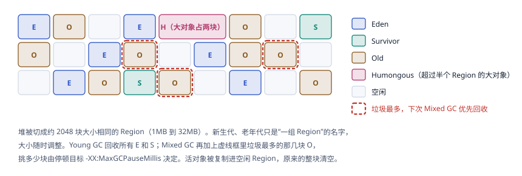

# 单元七 垃圾收集器：从 Serial 到 ZGC

本单元的核心：收集器的演进只做一件事：**把 STW 越切越短**。从“全停下来一起扫”，到“边跑边扫，只停一小下”。代价是更复杂的屏障、更多的 CPU 和内存。

**学完这个单元，你能：**

- 说出主流收集器的分工、算法和适用场景，以及 JDK 8、17、21 的默认收集器。
- 讲清三色标记为什么会漏标，以及 CMS 和 G1 分别怎么解决。
- 根据堆大小、延迟要求和 JDK 版本选择收集器，并说出低停顿收集器的代价。

单元六讲的是算法，本单元讲把算法落地的“收集器”。顺序是：先定下评价收集器的三个指标（7.1），再看只会 STW 的串行、并行收集器（7.2），然后解决“边跑边标记”带来的漏标难题（7.3），在此基础上看 CMS（7.4）、G1（7.5）、ZGC（7.6），最后用同一个负载实测对比，并给出选择建议（7.7）。

## 7.1 三个指标：吞吐量、停顿时间、内存占用

- **吞吐量**：业务代码运行时间占总时间的比例。批处理任务最在乎它。
- **停顿时间**：单次 STW 有多长。接口服务最在乎它，一次 500ms 的停顿就可能让请求超时。
- **内存占用**：为了回收，额外需要多少内存（记忆集、预留空间等）。

三者很难同时做到最好。好比打扫房间：把人全赶出去一口气扫完，扫得最快（吞吐高），但大家在门外等得久（停顿长）；让大家照常住着、清洁工见缝插针地扫，没人需要等（停顿短），但清洁工要多雇几个，还得一直盯着大家又扔了什么（CPU 和屏障开销）。

## 7.2 串行与并行：Serial、ParNew、Parallel

| 收集器 | 区域 | 算法 | 回收时 | 特点 |
| --- | --- | --- | --- | --- |
| Serial | 新生代 | 复制 | 单线程，STW | 最简单，额外开销最小 |
| Serial Old | 老年代 | 标记-整理 | 单线程，STW | 和 Serial 搭配 |
| ParNew | 新生代 | 复制 | 多线程，STW | Serial 的多线程版，以前专门配合 CMS，随 CMS 一起退场 |
| Parallel Scavenge | 新生代 | 复制 | 多线程，STW | 关注吞吐量，可自动调节各区大小 |
| Parallel Old | 老年代 | 标记-整理 | 多线程，STW | 和 Parallel Scavenge 搭配，**JDK 8 的默认组合** |

这几个收集器回收时都要 STW。多线程只是让停顿变短，并没有消除停顿，而且停顿时间随堆增大而增长：要扫描、复制的对象越多，停得越久。

## 7.3 并发标记的难题：三色标记与漏标

想缩短停顿，最耗时的“标记”就得和业务线程**并发**进行。描述并发标记的标准模型是**三色标记**：

- **白色**：还没被访问过。标记结束时还是白色的，就是垃圾。
- **灰色**：自己已经被访问到，但它引用的对象还没扫完。
- **黑色**：自己和它引用的对象都扫完了。

标记从 GC Roots 开始，把根直接引用的对象染灰，然后不断取一个灰色对象，把它引用的白色对象染灰，自己染黑，直到没有灰色对象。

问题出在业务线程一边跑一边改引用。如果下面**两个条件同时发生**，一个活对象会一直是白色，被当作垃圾回收掉，这叫**漏标**：

1. 一个**黑色**对象新增了一条指向某个**白色**对象的引用。黑色对象不会再被扫描，这条新引用没人发现。
2. **所有灰色**对象到这个白色对象的引用都被删掉了。原本能顺着灰色对象找到它，现在路断了。

活对象被回收，程序就会访问到已经释放的内存，后果不堪设想。所以并发收集器都会借助**写屏障**（6.4 节）破坏其中一个条件：

| 方案 | 破坏哪个条件 | 怎么做 | 谁在用 |
| --- | --- | --- | --- |
| 增量更新 | 条件 1 | 黑色对象新增引用时，把它记下来；最后 STW 重新标记一次，把这些对象重新扫一遍 | CMS |
| 原始快照（SATB） | 条件 2 | 删除引用时，把被删的旧引用记下来，当作灰色继续扫；相当于按“开始标记那一刻的快照”来标记 | G1、Shenandoah |

两种方案都可能把一些本该回收的对象多留一轮，这些叫**浮动垃圾**，下次 GC 再回收就行，不影响正确性。漏标是致命的，多标只是浪费一点空间。

## 7.4 CMS：第一款并发收集器

CMS（Concurrent Mark Sweep）是老年代收集器，用标记-清除算法，目标是缩短停顿。它分四步：

1. **初始标记**（STW）：只标记 GC Roots 直接引用的对象，很快。
2. **并发标记**：顺着引用链标记整个老年代，和业务线程同时运行，耗时最长。
3. **重新标记**（STW）：处理并发标记期间增量更新记下的对象。
4. **并发清除**：清掉没被标记的对象，和业务线程同时运行。

最耗时的两步都和业务线程并发，所以停顿短。它的问题也很明显：

- **内存碎片**：标记-清除不整理，碎片多了，大对象找不到连续空间，只能来一次 Full GC 整理。
- **浮动垃圾和预留空间**：并发清除时业务线程还在分配对象，所以老年代不能等满了才回收，要提前留出空间。留的空间不够用，就会发生“并发失败”（Concurrent Mode Failure），退化成单线程的 Serial Old 做 Full GC，停顿反而更长。
- **抢 CPU**：并发阶段要占用一部分 CPU 核心，核数少时对业务影响明显。

CMS 在 JDK 9 被标记为废弃，JDK 14 被移除。

## 7.5 G1：把堆切成 Region

G1（Garbage First）是 **JDK 9 起的默认收集器**，目标是在可控的停顿时间内获得尽可能高的吞吐量。

**Region**：G1 不再把堆切成固定的新生代和老年代，而是切成大约 2048 个大小相同的 **Region**，每个 1MB 到 32MB（2 的幂）。每个 Region 在不同时刻扮演不同角色：Eden、Survivor、Old，或者 **Humongous**（存放超过半个 Region 的大对象，一个放不下就占连续的多个）。新生代和老年代只是“一组 Region”的逻辑名称，大小可以动态调整。

- 这台机器默认最大堆 6GB，`-XX:+PrintFlagsFinal` 显示 `G1HeapRegionSize` 是 4MB。
- 9.1 节那个 256MB 堆的进程，`jcmd GC.heap_info` 显示 `region size 1024K`。



**停顿可预测**：用 `-XX:MaxGCPauseMillis` 设一个停顿目标（默认 200ms）。G1 记录每个 Region 里有多少垃圾、回收它要花多久，每次只挑**回收价值最高**（垃圾最多）的若干个 Region，在目标时间内回收。“Garbage First”的名字就是这么来的。

**G1 的三种活动**：

1. **Young GC**（STW）：Eden 用完时触发，把所有 Eden 和 Survivor Region 里的活对象复制到新的 Survivor 或 Old Region。
2. **并发标记**：堆占用超过阈值（默认 45%）时启动。初始标记搭 Young GC 的便车，然后并发标记，再经过两个很短的 STW 阶段：最终标记（Remark）处理 SATB 记录，清理（Cleanup）统计每个 Region 的存活情况。
3. **Mixed GC**（STW）：回收所有新生代 Region，外加一部分垃圾最多的老年代 Region。

回收速度跟不上分配速度时，G1 也会退化成 Full GC。

7.7 节实测的 G1 日志里，这三种活动都能看到（节选）：

```text
GC(0) Pause Young (Normal) (G1 Evacuation Pause) 110M->111M(2048M) 16.331ms
GC(14) Pause Young (Concurrent Start) (G1 Evacuation Pause) 1262M->1118M(2048M) 22.242ms
GC(15) Pause Remark 1390M->1390M(2048M) 0.300ms
GC(15) Pause Cleanup 1593M->1593M(2048M) 0.368ms
GC(21) Pause Young (Mixed) (G1 Evacuation Pause) 1683M->1444M(2048M) 10.250ms
```

- `Normal` 是普通的 Young GC；`Concurrent Start` 是搭了便车、顺带做初始标记的那次 Young GC。
- Remark 和 Cleanup 是并发标记中的两个短暂停顿，都不到 0.5ms。
- Mixed GC 在日志里也写作 `Pause Young (Mixed)`，这一次把堆从 1683M 收到了 1444M，比普通 Young GC 多回收了一部分老年代。

那次运行 10 秒内，带 `Pause Young` 的停顿共 221 次（其中 Mixed 90 次），最长 31ms。

和 CMS 相比，G1 回收时把活对象从一个 Region 复制到另一个，整体上相当于标记-整理，**没有碎片问题**。代价是更多的内存：每个 Region 都有自己的记忆集，记录“谁引用了我”。9.5 节的本地内存统计里，一个 256MB 堆的进程，GC 自己的数据结构就占了约 55MB。

## 7.6 ZGC：停顿不超过 1 毫秒

ZGC 的目标是：无论堆多大（从几百 MB 到 16TB），停顿都不超过 1 毫秒。前面的收集器里，“移动对象”（复制、整理）都必须 STW，因为对象一挪，所有指向它的引用都要改，业务线程不能在这时去读。ZGC 做到了**并发整理**：业务线程运行的同时搬动对象。靠的是两样东西：

- **染色指针**：把 GC 需要的状态（这个对象标记过没有、是否已经被搬走）直接存在 64 位引用的几个高位上，而不是存在对象头里。
- **读屏障**：业务线程每次从堆里读出一个引用，JVM 都插入一小段检查。如果发现指针的“颜色”表明对象已经被搬走，就顺手把引用改成新地址，下次再读就不用检查了（叫“自愈”）。

这样，搬家可以慢慢并发地做，谁先读到旧地址，谁就顺手修正。只剩三个极短的 STW 阶段，只处理 GC Roots，与堆的大小无关。7.7 节实测中，ZGC 的三种停顿共 151 次，最长的一次是 **0.021ms**：

```text
GC(0) Pause Mark Start 0.003ms
GC(0) Pause Mark End 0.008ms
GC(0) Pause Relocate Start 0.008ms
```

**版本**：JDK 11 实验性引入，JDK 15 可用于生产；JDK 21 加入分代 ZGC（`-XX:+UseZGC -XX:+ZGenerational`），JDK 23 起分代成为默认，JDK 24 移除了不分代的模式。

**代价**：

- 读屏障让每次读引用都多一点开销，吞吐量通常比 G1 低一些。
- 染色指针占用了引用的高位，不能用 4.3 节的压缩指针，同样的对象占内存更多。
- **回收速度跟不上分配速度时，ZGC 会让分配对象的线程停下来等**，叫 Allocation Stall。同一个测试负载把堆从 2GB 缩到 1GB，JDK 17 的 ZGC 日志里就出现了 `Allocation Stall (main) 57.635ms`：GC 本身的停顿仍然不到 1ms，业务线程却被卡了 57ms。所以用 ZGC 要给堆留足余量。

Shenandoah 是 Red Hat 开发的另一款并发整理收集器，思路相近，包含在 OpenJDK 里（Oracle JDK 不带）。

## 7.7 实测：同一个负载，四种收集器

`examples/GcCompare.java` 在堆里常驻约 400MB 小对象，不停地随机替换其中一部分（制造老年代垃圾），同时大量分配短命对象，运行 10 秒。主线程每做 1000 次操作记一次耗时，正常一批不到 0.1ms，最慢的一批就是被 GC 卡住最久的那一次。JDK 17、`-Xms2g -Xmx2g` 实测：

| 收集器 | GC 日志里的停顿 | 最长一次停顿 | 10 秒内停顿合计 | 业务线程最长卡顿 |
| --- | --- | --- | --- | --- |
| Serial | Young 36 次，Full 6 次 | 466 ms | 7.1 s | 465.8 ms |
| Parallel | Young 71 次，Full 6 次 | 164 ms | 6.3 s | 219.0 ms |
| G1 | Young 和 Mixed 共 221 次，Remark、Cleanup 各 21 次 | 31 ms | 2.9 s | 31.0 ms |
| ZGC | 三种 Pause 共 151 次 | 0.021 ms | 0.7 ms | 0.8 ms |

- 停顿时间从 Serial 到 ZGC 差了四个数量级，“把 STW 越切越短”在数据上一目了然。
- Serial 和 Parallel 在 10 秒里停了 6 秒多。这个负载不停地往老年代的大数组里写新生代对象，每次 Young GC 都要扫大量脏卡（6.4 节），所以它们的 Young GC 也很慢。
- 这个测试只有一个业务线程，G1 和 ZGC 的并发阶段可以用其他空闲的核，所以它不能说明谁的吞吐量更高，只用来比较停顿。

**怎么选**：

| 场景 | 建议 |
| --- | --- |
| 堆只有几百 MB，单核容器、命令行小工具 | Serial |
| 批处理、离线计算，只关心总耗时 | Parallel |
| 大多数服务端应用，堆几 GB 到几十 GB，停顿要求百毫秒级 | G1 |
| 停顿要求在毫秒以内，或者堆特别大 | ZGC（JDK 21 起用分代 ZGC） |

**默认收集器**：JDK 8 是 Parallel；JDK 9 起是 G1。但 JVM 只有判断自己运行在“服务器级机器”上（至少 2 个 CPU 且至少约 1.8GB 内存）时才默认用 G1，否则用 Serial。容器里只分了 1 个 CPU 的服务，默认收集器其实是 Serial。用 `java -XX:+PrintCommandLineFlags -version` 可以看到实际选了哪个。

## 面试这样说

**问：CMS 和 G1 有什么区别？**

> CMS 只管老年代，用标记-清除，分初始标记、并发标记、重新标记、并发清除四步，最耗时的两步和业务线程并发，所以停顿短；但它会产生碎片，并发失败时退化成单线程 Full GC，JDK 14 已被移除。G1 把堆切成大小相等的 Region，每个 Region 可以是 Eden、Survivor、Old 或 Humongous，新生代老年代只是逻辑上的一组 Region；它能设置停顿目标，每次挑垃圾最多的 Region 回收，Region 之间用复制，整体上没有碎片。代价是每个 Region 要维护记忆集，内存开销更大。JDK 9 起 G1 是默认收集器。

**问：并发标记时应用还在修改引用，怎么避免漏标？**

> 用三色标记来描述：白色没访问，灰色访问了但引用没扫完，黑色全部扫完。漏标需要同时满足两个条件：黑色对象新增了指向白色对象的引用，并且灰色对象到这个白色对象的引用全被删了。破坏任意一个就行：CMS 用增量更新，黑色对象新增引用时用写屏障记下来，重新标记时再扫一遍；G1 用原始快照 SATB，删除引用时把旧引用记下来继续扫。代价是会产生浮动垃圾，留到下次回收。

**问：ZGC 为什么停顿这么短？有什么代价？**

> 停顿长主要是因为移动对象时要停下业务线程。ZGC 用染色指针加读屏障实现了并发整理：GC 状态存在引用的高位，业务线程读引用时读屏障检查颜色，发现对象被搬走了就顺手修正指针，所以搬对象可以和业务并发。只剩几个只处理 GC Roots 的极短停顿，和堆大小无关，一般在 1 毫秒以内。代价是读屏障降低一些吞吐，不能用压缩指针，而且回收跟不上分配时会让分配线程停下来等，所以要留足堆空间。

## 自测

- [ ] 吞吐量和停顿时间为什么很难同时做到最好？
- [ ] 三色标记中，漏标需要同时满足哪两个条件？增量更新和 SATB 各破坏了哪一个？
- [ ] CMS 有哪几个阶段？哪几个要 STW？它有什么缺点？
- [ ] G1 的 Region 有哪几种角色？大对象放在哪？
- [ ] G1 怎么做到“停顿时间可预测”？
- [ ] ZGC 是怎么在业务线程运行的同时移动对象的？
- [ ] GC 停顿只有零点几毫秒的 ZGC，为什么也可能让业务线程卡住几十毫秒？
- [ ] JDK 8、JDK 17 的默认收集器分别是什么？一个只分了 1 个 CPU 的容器里呢？
